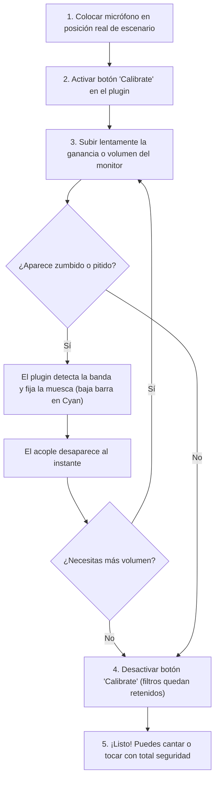

# Guía de Uso e Instrucciones de Plugins (DAW & Live)

Este documento contiene la guía operativa detallada, parámetros, flujos de calibración y mejores prácticas para cada uno de los plugins de audio desarrollados en este repositorio.

---

## Tabla de Contenidos
1. [Noise Gate (Stereo RMS Noise Gate)](#1-noise-gate-stereo-rms-noise-gate)
   - [Propósito y Posición en la Cadena](#propósito-y-posición-en-la-cadena)
   - [Descripción de Parámetros y Controles](#descripción-de-parámetros-y-controles)
   - [Cómo Leer los Medidores](#cómo-leer-los-medidores)
   - [Guía Paso a Paso de Configuración](#guía-paso-a-paso-de-configuración)
   - [Presets Recomendados y Casos de Uso](#presets-recomendados-y-casos-de-uso)
   - [Solución de Problemas Comunes](#solución-de-problemas-comunes)
2. [Feedback Suppressor (Surgical Notch Suppressor)](#2-feedback-suppressor-surgical-notch-suppressor)
   - [Propósito y Posición en la Cadena](#propósito-y-posición-en-la-cadena-1)
   - [Descripción de Parámetros y Controles](#descripción-de-parámetros-y-controles-1)
   - [Visualizador de Supresión de Acople](#visualizador-de-supresión-de-acople)
   - [Flujo de Calibración de Sala ("Ringing Out")](#flujo-de-calibración-de-sala-ringing-out)
   - [Presets Recomendados y Casos de Uso](#presets-recomendados-y-casos-de-uso-1)
   - [Solución de Problemas Comunes](#solución-de-problemas-comunes-1)
3. [Estándar de Mantenimiento de esta Documentación](#3-estándar-de-mantenimiento-de-esta-documentación)

---

## 1. Noise Gate (Stereo RMS Noise Gate)

El **Noise Gate** es una compuerta de ruido de alta precisión diseñada para limpiar pistas vocales, guitarras eléctricas, micrófonos de batería o instrumentos en vivo, silenciando o atenuando el canal cuando la señal útil cae por debajo del umbral deseado.

Utiliza un detector de envolvente **RMS** con integración de 10 ms enlazado en estéreo ($\sqrt{(L^2 + R^2)/2}$) y envolventes analíticas $C^1$ para garantizar transiciones suaves y libres de "clicks" o ruidos de conmutación (*zipper noise*).

### Propósito y Posición en la Cadena

- **Pistas Vocales**: Se coloca al **inicio de la cadena de inserción**, antes de compresores, ecualizadores saturadores o reverbs. Si se coloca después de un compresor, el suelo de ruido habrá sido levantado por la compresión y será más difícil separarlo de la voz.
- **Guitarras Eléctricas (High Gain / Metal)**: Se coloca **inmediatamente después de la guitarra o pedal de distorsión/overdrive**, pero **antes de delays y reverberaciones** para evitar cortar las colas de los efectos de tiempo.
- **Baterías Acústicas (Caja / Toms / Bombo)**: Primer plugin para eliminar el sangrado (*bleed*) de los platos y otros cuerpos de la batería entre golpes.

```text
Micrófono / Entrada ──► [ Noise Gate ] ──► [ EQ / Compresión ] ──► [ Time FX (Delay/Reverb) ]
```

### Descripción de Parámetros y Controles

| Control | Rango | Unidad | Defecto | Tipo / Escala | Descripción Operativa |
| :--- | :---: | :---: | :---: | :---: | :--- |
| **Threshold** | `-80.0` a `0.0` | dB | `-40.0` | Knob (Lineal) | **Umbral de activación**. Nivel por encima del cual la compuerta se abre para dejar pasar el audio. Por debajo de este nivel, la señal se atenúa hacia el valor de `Floor`. |
| **Attack** | `0.1` a `200.0` | ms | `5.0` | Knob (Logarítmico) | **Tiempo de apertura**. Velocidad a la que la compuerta pasa de cerrada a abierta al superar el umbral. Valores rápidos (0.1–2 ms) capturan transitorios de percusión; valores de 5–15 ms evitan clicks en voces. |
| **Hold** | `0.0` a `1000.0` | ms | `50.0` | Knob (Lineal) | **Tiempo de retención**. Milisegundos exactos que la compuerta se mantiene 100% abierta tras caer por debajo del umbral, antes de iniciar el Release. Previene el parpadeo molesto (*chattering*). |
| **Release** | `1.0` a `2000.0` | ms | `150.0` | Knob (Logarítmico) | **Tiempo de decaimiento**. Tiempo que tarda la compuerta en cerrarse suavemente hasta alcanzar el nivel de `Floor`. Evita cortes bruscos al final de palabras o notas sostenidas. |
| **Floor** | `-80.0` a `0.0` | dB | `-60.0` | Knob (Lineal) | **Suelo de atenuación**. Ganancia aplicada cuando la compuerta está cerrada. En `-80 dB` produce silencio absoluto; en `-18 dB` a `-24 dB` reduce el ruido sin generar un vacío antinatural. |

### Cómo Leer los Medidores

El panel lateral derecho muestra dos barras verticales de medición continua:
1. **`Input RMS` (dB)**: Representa el nivel energético medio de entrada. Úsalo para ubicar visualmente dónde se encuentra tu suelo de ruido cuando no hay interpretación y dónde caen los picos al cantar o tocar.
2. **`Gate Gain` (dB)**: Indica la ganancia instantánea que el plugin está aplicando a la señal:
   - **`0 dB`**: La compuerta está totalmente abierta (la señal pasa intacta).
   - **Entre `0 dB` y el valor de `Floor`**: La compuerta está en proceso de apertura o cierre (*Attack / Release*).
   - **Nivel igual a `Floor`**: La compuerta está cerrada, atenuando el ruido base.

### Guía Paso a Paso de Configuración

1. **Monitorea el ruido de fondo**: Con el micrófono encendido o la guitarra conectada, no toques ni hables. Observa el nivel en el medidor **`Input RMS`** (por ejemplo, oscila alrededor de `-52 dB`).
2. **Fija el Threshold**: Sube el control **`Threshold`** hasta unos 3 a 6 dB por encima de la lectura de ruido (siguiendo el ejemplo anterior, colócalo en torno a `-46 dB`). Comprueba que el medidor **`Gate Gain`** baje de inmediato al nivel de **`Floor`**.
3. **Comprueba la interpretación útil**: Canta o toca la nota más suave de tu pasaje musical. Asegúrate de que **`Gate Gain`** suba instantáneamente a `0 dB` sin comerse el inicio de la nota.
4. **Ajusta Attack**:
   - Para instrumentos de percusión o guitarras rítmicas con púa fuerte: usa entre `0.1 ms` y `2 ms`.
   - Para voces o instrumentos de cuerda frotada: usa entre `5 ms` y `12 ms` para evitar clicks audibles.
5. **Ajusta Hold y Release para la cola natural**:
   - Si al finalizar una palabra o acorde la nota se corta de golpe ("gating" evidente), incrementa **`Hold`** a `80–150 ms` y **`Release`** a `200–400 ms`.
6. **Ajusta el Floor**: Si el silencio total suena poco natural en la mezcla, sube **`Floor`** a `-20 dB` o `-18 dB`. El ruido se reducirá considerablemente sin crear un vacío incómodo de ambiente.

### Presets Recomendados y Casos de Uso

| Escenario | Threshold | Attack | Hold | Release | Floor |
| :--- | :---: | :---: | :---: | :---: | :---: |
| **Voz Estudio / Podcast** | `-42 dB` | `8.0 ms` | `80 ms` | `220 ms` | `-24 dB` |
| **Guitarra High Gain / Djent** | `-35 dB` | `0.5 ms` | `15 ms` | `40 ms` | `-70 dB` |
| **Caja de Batería (Snare)** | `-30 dB` | `0.1 ms` | `30 ms` | `90 ms` | `-60 dB` |
| **Bajo Eléctrico / Teclado** | `-48 dB` | `12.0 ms` | `100 ms` | `350 ms` | `-30 dB` |

### Solución de Problemas Comunes

- **El audio "parpadea" o tiembla (chattering) al final de las frases**:
  - *Causa*: El umbral está demasiado cerca del nivel de la señal sostenida.
  - *Solución*: Incrementa el parámetro **`Hold`** (a `80–150 ms`) y baja ligeramente el **`Threshold`** (2–3 dB).
- **Se corta el transitorio inicial de la palabra o golpe**:
  - *Causa*: El tiempo de ataque es demasiado lento o el umbral está demasiado alto.
  - *Solución*: Reduce el tiempo de **`Attack`** a `1–3 ms` y baja el **`Threshold`**.
- **Se percibe un "click" acústico al abrir o cerrar la compuerta**:
  - *Causa*: Ataque excesivamente rápido (<0.2 ms) en señales de baja frecuencia.
  - *Solución*: Incrementa levemente **`Attack`** a `2–5 ms` para permitir un cruce por cero suave.

---

## 2. Feedback Suppressor (Surgical Notch Suppressor)

El **Feedback Suppressor** es un procesador quirúrgico y analítico diseñado para detectar y destruir acoples acústicos (*feedback*, pitidos de Larsen o zumbidos resonantes) en tiempo récord (1.5 ms de ataque), permitiendo aumentar sustancialmente la ganancia utilizable (*Gain Before Feedback*) en micrófonos e instrumentos acústicos sin afectar la ecualización, el brillo ni la dinámica musical.

Incorpora un banco de 8 detectores de prominencia tonal en frecuencias críticas del espectro acústico (`160 Hz` a `10 kHz`), filtros notch de factor $Q$ elevado (hasta 60), memoria de calibración de sala (*room resonance peak-hold*) y un visualizador gráfico con medidores de corte descendentes en Cyan Ableton (`#00D2FF`).

### Propósito y Posición en la Cadena

- **Canal de Micrófono Vocal o Guitarra Acústica**: Ubicar como **primer plugin en la pista**, inmediatamente después de la ganancia de entrada y antes de compresores, excitadores o ecualizadores creativos.
- **Bus Maestro o Envío de Monitores de Escenario**: También puede insertarse en el bus de salida auxiliar hacia monitores de cuña (*stage wedges*) o altavoces principales (*PA Front of House*) para proteger el sistema completo contra retroalimentación acústica.

```text
Micrófono en Escenario ──► [ Feedback Suppressor ] ──► [ Preamp / Procesadores ] ──► Altavoz / Monitor
                                 ▲                                                        │
                                 └────────── Lazo Acústico de Acople (Eliminado) ─────────┘
```

### Descripción de Parámetros y Controles

| Control | Rango | Unidad | Defecto | Tipo / Escala | Descripción Operativa |
| :--- | :---: | :---: | :---: | :---: | :--- |
| **Calibrate** | `0` / `1` | On/Off | `Off` | Checkbox | **Interruptor de Calibración de Sala**. Al activarse, activa el latch de retención de picos (*room peak-hold*). Cualquier resonancia de la sala detectada durante la prueba queda fijada y memorizada permanentemente, incluso cuando el acople cede. |
| **Reset** | Pulsador | Trigger | - | Botón | **Limpieza de Memoria**. Limpia instantáneamente las muescas memorizadas y restablece todos los filtros notch a $0\text{ dB}$ para permitir una nueva calibración en un nuevo entorno. |
| **Sensitivity**| `-60.0` a `-6.0` | dB | `-30.0` | Knob (Lineal) | **Sensibilidad de Detección**. Umbral por encima del cual una resonancia tonal concentrada se clasifica como acople. Si notas que tarda en dispararse ante un pitido bajo, aumenta la sensibilidad a `-40 dB`; si corta notas musicales largas, súbela a `-24 dB`. |
| **Max Cut** | `-48.0` a `0.0` | dB | `-24.0` | Knob (Lineal) | **Profundidad Máxima de Muesca**. Define cuántos decibelios de atenuación máxima puede aplicar el filtro notch sobre el acople. Con `-24 dB` a `-36 dB` se destruye cualquier acople habitual sin vaciar el cuerpo de la señal. |
| **Sharpness** | `10.0` a `60.0` | Q | `35.0` | Knob (Lineal) | **Anchura Quirúrgica (Factor Q)**. Factor de calidad de los filtros notch. Un valor alto ($Q = 35–50$) asegura que el filtro sea extremadamente estrecho, cortando únicamente el tono de acople sin remover las notas o armónicos vecinos. |
| **Gain** | `-12.0` a `+18.0` | dB | `0.0` | Knob (Lineal) | **Ganancia de Salida Limpia**. Permite compensar o aprovechar el margen de ganancia adicional (*headroom*) obtenido tras suprimir los acoples, aumentando el volumen general sin peligro. |

### Visualizador de Supresión de Acople

El panel gráfico de la derecha está compuesto por 9 barras de medición:
- **Medidores de Muesca `[160Hz]` a `[10k]`**: 8 barras verticales en Cyan Ableton (`#00D2FF`) que miden el corte en dB desde $0\text{ dB}$ (arriba, reposo) hacia abajo (hasta `-48 dB`).
  - Si una frecuencia acopla (por ejemplo, `2.2 kHz`), la barra correspondiente descenderá inmediatamente reflejando exactamente cuántos decibelios de supresión quirúrgica están siendo aplicados.
  - Al detenerse el acople en modo normal, la barra se recuperará suavemente hacia arriba tras 350 ms. En modo calibrado, se mantendrá retenida en la profundidad necesaria para que el acople no vuelva a nacer.
- **Medidor `[In]`**: Barra de nivel RMS de entrada en dB (`-60 dB` a `0 dB`) para vigilar la presencia y ganancia del micrófono en vivo.

### Flujo de Calibración de Sala ("Ringing Out")

Para obtener el máximo volumen en un escenario o habitación antes de que empiece el espectáculo o ensayo, sigue este procedimiento profesional:



1. **Prepara el escenario**: Conecta el micrófono y colócalo en su soporte en la posición habitual donde se usará (apuntando hacia los monitores o altavoces como ocurriría en el show).
2. **Activa `Calibrate`**: Haz clic en la casilla de verificación **`Calibrate`**. El plugin entra en modo escucha analítica.
3. **Sube el volumen gradualmente**: Sube poco a poco la ganancia del previo o el fader del canal en el DAW/consola hasta que la sala empiece a resonar o amenace con acoplar levemente (*ringing out*).
4. **Observa la destrucción del acople**: En cuanto empiece el tono de acople, el visualizador bajará inmediatamente la barra de la frecuencia culpable (por ejemplo, `3.8k` o `1.2k`) y el pitido desaparecerá al instante.
5. **Gana margen de volumen**: Puedes subir 3 a 6 dB adicionales de ganancia. Si una segunda frecuencia intenta acoplar, el plugin la atrapará también.
6. **Desactiva `Calibrate`**: Una vez alcanzado el volumen deseado, desmarca **`Calibrate`**. Las muescas descubiertas permanecerán bloqueadas en memoria durante toda la sesión.
7. **Reiniciar si cambias de lugar**: Si mueves los altavoces o cambias de micrófono, pulsa **`Reset`** para limpiar las muescas y repite el proceso en 10 segundos.

### Presets Recomendados y Casos de Uso

| Escenario | Sensitivity | Max Cut | Sharpness (Q) | Calibrate | Gain |
| :--- | :---: | :---: | :---: | :---: | :---: |
| **Monitores de Voz en Directo** | `-32 dB` | `-28 dB` | `40 Q` | Activo en Soundcheck | `+2.0 dB` |
| **Guitarra Electroacústica con Pastilla** | `-28 dB` | `-32 dB` | `45 Q` | Activo en Soundcheck | `0.0 dB` |
| **Ensayo en Local Pequeño / Garaje** | `-36 dB` | `-24 dB` | `35 Q` | Dinámico continuo (`Calibrate Off`) | `+1.0 dB` |
| **Podcasting / Streaming con Altavoces Abiertos** | `-40 dB` | `-20 dB` | `30 Q` | Dinámico continuo | `0.0 dB` |

### Solución de Problemas Comunes

- **El acople persiste o tarda en ser eliminado**:
  - *Causa*: El umbral de sensibilidad está demasiado alto o la resonancia es débil inicialmente.
  - *Solución*: Gira **`Sensitivity`** hacia la izquierda (por ejemplo, pásala de `-30 dB` a `-40 dB`).
- **El tono de una nota larga cantada o tocada se atenúa ligeramente**:
  - *Causa*: El factor $Q$ es demasiado ancho o la sensibilidad es excesivamente agresiva, confundiendo una nota sostenida perfecta con retroalimentación.
  - *Solución*: Incrementa **`Sharpness`** a `45–55 Q` para estrechar el filtro quirúrgico, y sube **`Sensitivity`** a `-24 dB`.
- **Deseo borrar todos los filtros memorizados**:
  - *Solución*: Haz clic en el botón **`Reset`**. Las barras volverán de inmediato a $0\text{ dB}$.

---

## 3. Estándar de Mantenimiento de esta Documentación

> [!IMPORTANT]
> **Norma Obligatoria para Desarrolladores y Agentes AI**:
> Cualquier nuevo plugin añadido al repositorio o cualquier modificación de parámetros existentes, lógica de control o medidores en los plugins actuales **DEBE REFLEJARSE OBLIGATORIAMENTE** en este archivo (`docs/PLUGIN-INSTRUCTIONS.md`) antes de finalizar la tarea.
> 
> Al documentar un plugin nuevo, asegúrate de proveer:
> 1. Resumen funcional y posición aconsejada en la cadena de inserción / master del DAW.
> 2. Tabla completa de parámetros (nombre, rango, unidad, valor por defecto, descripción).
> 3. Guía de lectura de medidores y visualizadores.
> 4. Procedimiento de configuración paso a paso.
> 5. Tabla de presets prácticos recomendados.
> 6. Guía de solución de problemas (*troubleshooting*).
